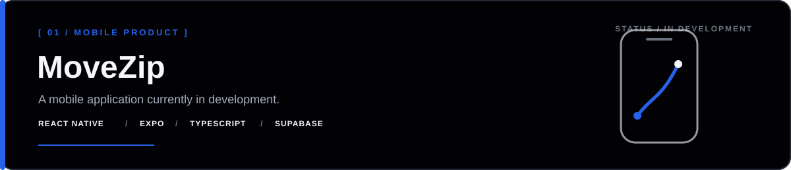
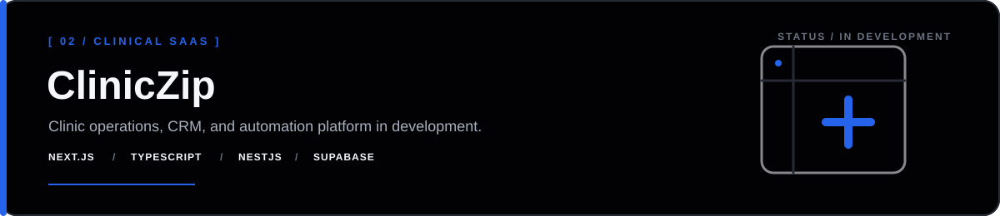
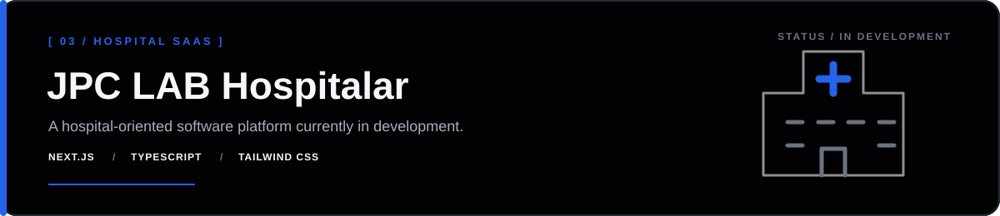
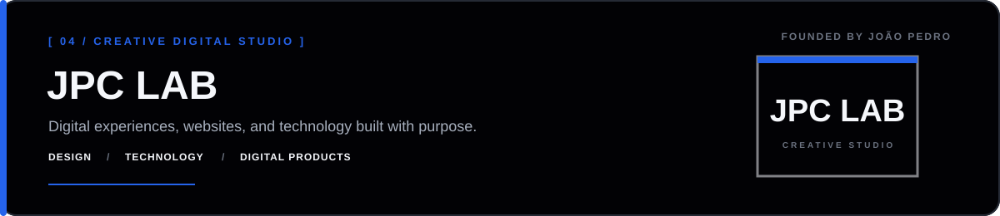

<p align="center">
  
</p>

<p align="center">
  <a href="https://jpclab.com.br"></a>
  <a href="mailto:contato@jpclab.com.br"></a>
  <a href="https://github.com/MoveZip"></a>
</p>

<p align="center">
  <strong>Founder &amp; Digital Product Builder @ JPC LAB</strong><br/>
  <sub>Software Engineering student · Brazil · Building for the web, mobile, and SaaS</sub>
</p>


## Hello, world — I'm João Pedro 👋

I'm a Software Engineering student and the founder of **[JPC LAB](https://jpclab.com.br)**. I build websites and digital products, explore modern technologies, and turn ideas into web, mobile, and SaaS experiences.

My work sits where product thinking, engineering, and design meet. I use AI-assisted development as part of my workflow while continuing to strengthen the fundamentals behind reliable software. Over the coming years, my focus is to grow into a highly capable software engineer who can design and build thoughtful, scalable technology.

```ts
const joao = {
  basedIn: "Brazil",
  role: "Founder & Digital Product Builder",
  education: "Software Engineering",
  building: ["websites", "mobile products", "SaaS"],
  mindset: "learn deeply, build carefully, improve continuously",
};
```


## Technology ecosystem

These are the technologies around my projects and learning journey — not a claim of equal mastery across every tool.

<h3 align="center">Languages &amp; Web Fundamentals</h3>

<table width="100%">
  <tr>
    <td align="center" width="20%"><br/><sub><b>JavaScript</b></sub></td>
    <td align="center" width="20%"><br/><sub><b>TypeScript</b></sub></td>
    <td align="center" width="20%"><br/><sub><b>Python</b></sub></td>
    <td align="center" width="20%"><br/><sub><b>HTML5</b></sub></td>
    <td align="center" width="20%"><br/><sub><b>CSS3</b></sub></td>
  </tr>
</table>

<h3 align="center">Frontend &amp; Mobile</h3>

<table width="100%">
  <tr>
    <td align="center" width="20%"><br/><sub><b>React</b></sub></td>
    <td align="center" width="20%">
      <picture><source media="(prefers-color-scheme: dark)" srcset="https://cdn.simpleicons.org/nextdotjs/FFFFFF"/><source media="(prefers-color-scheme: light)" srcset="https://cdn.simpleicons.org/nextdotjs/000000"/></picture><br/><sub><b>Next.js</b></sub>
    </td>
    <td align="center" width="20%"><br/><sub><b>React Native</b></sub></td>
    <td align="center" width="20%">
      <picture><source media="(prefers-color-scheme: dark)" srcset="https://cdn.simpleicons.org/expo/FFFFFF"/><source media="(prefers-color-scheme: light)" srcset="https://cdn.simpleicons.org/expo/000020"/></picture><br/><sub><b>Expo</b></sub>
    </td>
    <td align="center" width="20%"><br/><sub><b>Tailwind CSS</b></sub></td>
  </tr>
</table>

<h3 align="center">Backend &amp; Databases</h3>

<table width="100%">
  <tr>
    <td align="center" width="20%"><br/><sub><b>Node.js</b></sub></td>
    <td align="center" width="20%"><br/><sub><b>NestJS</b></sub></td>
    <td align="center" width="20%">
      <picture><source media="(prefers-color-scheme: dark)" srcset="https://cdn.simpleicons.org/express/FFFFFF"/><source media="(prefers-color-scheme: light)" srcset="https://cdn.simpleicons.org/express/000000"/></picture><br/><sub><b>Express.js</b></sub>
    </td>
    <td align="center" width="20%"><br/><sub><b>PostgreSQL</b></sub></td>
    <td align="center" width="20%"><br/><sub><b>Supabase</b></sub></td>
  </tr>
</table>

<h3 align="center">Tools &amp; Engineering</h3>

<table width="100%">
  <tr>
    <td align="center" width="16.66%"><br/><sub><b>Git</b></sub></td>
    <td align="center" width="16.66%">
      <picture><source media="(prefers-color-scheme: dark)" srcset="https://cdn.simpleicons.org/github/FFFFFF"/><source media="(prefers-color-scheme: light)" srcset="https://cdn.simpleicons.org/github/181717"/></picture><br/><sub><b>GitHub</b></sub>
    </td>
    <td align="center" width="16.66%"><br/><sub><b>Docker</b></sub></td>
    <td align="center" width="16.66%"><br/><sub><b>GitHub Actions</b></sub></td>
    <td align="center" width="16.66%"><br/><sub><b>VS Code</b></sub></td>
    <td align="center" width="16.66%"><br/><sub><b>Figma</b></sub></td>
  </tr>
</table>


## Products in focus

The implementation repositories are private while the products are being developed. The cards below share the public story and verified technology choices without exposing private code or internal documentation.

<p align="center"></p>

<p align="center"></p>

<p align="center"></p>

<p align="center"><a href="https://jpclab.com.br"></a></p>


## Currently learning

<table width="100%">
  <tr>
    <td width="50%" valign="top">
      <h3>Languages &amp; product engineering</h3>
      <ul>
        <li>JavaScript, TypeScript, and Python</li>
        <li>React and Next.js</li>
        <li>Web and mobile product development</li>
      </ul>
    </td>
    <td width="50%" valign="top">
      <h3>Computer science &amp; systems</h3>
      <ul>
        <li>Software Engineering fundamentals</li>
        <li>Algorithms and Data Structures</li>
        <li>Software Architecture</li>
      </ul>
    </td>
  </tr>
</table>

> My goal is steady, evidence-based growth: learn the fundamentals, apply them to real products, and keep raising the quality of what I build.


## GitHub activity

Most of my current product work lives in private repositories, so public language percentages and third-party rank cards would give an incomplete picture. GitHub's native contribution graph below this profile remains the source of truth for public activity, while released work will appear in the repositories tab over time.

<p align="center">
  <a href="https://github.com/MoveZip?tab=repositories"></a>
  <a href="https://github.com/MoveZip?tab=overview"></a>
</p>


## Let's build something thoughtful

I'm interested in learning from strong engineering teams, collaborating on meaningful products, and connecting with people who care about useful technology and excellent craft.

<p align="center">
  <a href="https://jpclab.com.br"><b>jpclab.com.br</b></a>
  &nbsp;·&nbsp;
  <a href="mailto:contato@jpclab.com.br"><b>contato@jpclab.com.br</b></a>
  &nbsp;·&nbsp;
  <a href="https://github.com/MoveZip"><b>@MoveZip</b></a>
</p>

<p align="center"></p>
