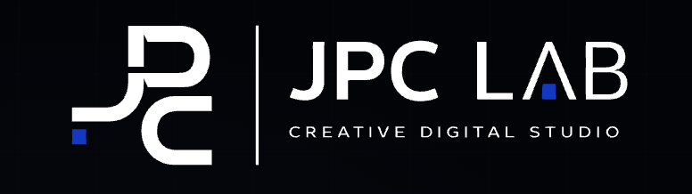

  

  <strong>Founder @ <a href="https://www.jpclab.com.br">JPC LAB</a></strong>
  &nbsp;&nbsp;·&nbsp;&nbsp;
  Software Engineering Student
  &nbsp;&nbsp;·&nbsp;&nbsp;
  Brazil

  <a href="https://www.jpclab.com.br">Website</a>
  &nbsp;&nbsp;/&nbsp;&nbsp;
  <a href="mailto:jpclabdigital@gmail.com">Email</a>
  &nbsp;&nbsp;/&nbsp;&nbsp;
  <a href="https://github.com/MoveZip">GitHub</a>

## About

I'm João Pedro, founder of **[JPC LAB](https://www.jpclab.com.br)** and a Software Engineering student based in Brazil. I build websites, digital products, and SaaS experiences, combining design, technology, and product thinking.

My current interests include software engineering, web and mobile development, technology entrepreneurship, product design, and AI-assisted development. I'm focused on developing strong technical foundations, applying what I learn to real products, and improving the quality of my work over time.

**Current direction:** Web Development · Mobile Applications · SaaS Products · Product Design · Continuous Learning

## Technology Ecosystem

The technologies below represent my project ecosystem and active learning path — not equal or advanced proficiency across every tool.

<h3 align="center">Languages &amp; Web Fundamentals</h3>

<table width="100%">
  <tr>
    <td align="center" width="20%"> <b>JavaScript</b></td>
    <td align="center" width="20%"> <b>TypeScript</b></td>
    <td align="center" width="20%"> <b>Python</b></td>
    <td align="center" width="20%"> <b>HTML5</b></td>
    <td align="center" width="20%"> <b>CSS3</b></td>
  </tr>
</table>

<h3 align="center">Frontend &amp; Mobile Development</h3>

<table width="100%">
  <tr>
    <td align="center" width="20%"> <b>React</b></td>
    <td align="center" width="20%"> <b>React Native</b></td>
    <td align="center" width="20%"><picture><source media="(prefers-color-scheme: dark)" srcset="https://cdn.simpleicons.org/nextdotjs/FFFFFF"/><source media="(prefers-color-scheme: light)" srcset="https://cdn.simpleicons.org/nextdotjs/000000"/></picture> <b>Next.js</b></td>
    <td align="center" width="20%"><picture><source media="(prefers-color-scheme: dark)" srcset="https://cdn.simpleicons.org/expo/FFFFFF"/><source media="(prefers-color-scheme: light)" srcset="https://cdn.simpleicons.org/expo/000020"/></picture> <b>Expo</b></td>
    <td align="center" width="20%"> <b>Tailwind CSS</b></td>
  </tr>
</table>

<h3 align="center">Backend &amp; Databases</h3>

<table width="100%">
  <tr>
    <td align="center" width="20%"> <b>Node.js</b></td>
    <td align="center" width="20%"> <b>NestJS</b></td>
    <td align="center" width="20%"><picture><source media="(prefers-color-scheme: dark)" srcset="https://cdn.simpleicons.org/express/FFFFFF"/><source media="(prefers-color-scheme: light)" srcset="https://cdn.simpleicons.org/express/000000"/></picture> <b>Express.js</b></td>
    <td align="center" width="20%"> <b>PostgreSQL</b></td>
    <td align="center" width="20%"> <b>Supabase</b></td>
  </tr>
</table>

<h3 align="center">Developer Tools</h3>

<table width="100%">
  <tr>
    <td align="center" width="16.66%"> <b>Git</b></td>
    <td align="center" width="16.66%"><picture><source media="(prefers-color-scheme: dark)" srcset="https://cdn.simpleicons.org/github/FFFFFF"/><source media="(prefers-color-scheme: light)" srcset="https://cdn.simpleicons.org/github/181717"/></picture> <b>GitHub</b></td>
    <td align="center" width="16.66%"> <b>Docker</b></td>
    <td align="center" width="16.66%"> <b>GitHub Actions</b></td>
    <td align="center" width="16.66%"> <b>VS Code</b></td>
    <td align="center" width="16.66%"> <b>Figma</b></td>
  </tr>
</table>

## Selected Work

These products are under active development in private repositories. The summaries below communicate their public direction and verified technology choices without exposing private code or internal documentation.

   
  Official JPC LAB identity · Founded by João Pedro

## Education &amp; Current Focus

**Software Engineering Student** — building a long-term foundation in software development through structured study and practical product work.

<table width="100%">
  <tr>
    <td width="50%" valign="top">
      <h3>Languages &amp; Product Development</h3>
      <ul>
        <li>JavaScript, TypeScript, and Python</li>
        <li>React and Next.js</li>
        <li>Backend Development and Databases</li>
        <li>Web and Mobile Applications</li>
      </ul>
    </td>
    <td width="50%" valign="top">
      <h3>Engineering Foundations</h3>
      <ul>
        <li>Algorithms and Data Structures</li>
        <li>Software Architecture</li>
        <li>Application Security and Software Testing</li>
        <li>Cloud and DevOps fundamentals</li>
      </ul>
    </td>
  </tr>
</table>

My focus is consistent, evidence-based progress: understanding the fundamentals, applying them to real products, and developing the judgment required to build reliable software.

## GitHub Activity

Most of my current product work is kept in private repositories. GitHub's native contribution graph below this profile is the most accurate public view of my activity; third-party rank and language cards are intentionally omitted because they would provide an incomplete picture.

  <a href="https://github.com/MoveZip?tab=overview">View activity</a>
  &nbsp;&nbsp;/&nbsp;&nbsp;
  <a href="https://github.com/MoveZip?tab=repositories">Explore repositories</a>

## Contact

I'm interested in learning from strong engineering teams, collaborating on thoughtful digital products, and connecting with people working across software, design, and technology entrepreneurship.

  
  
  

