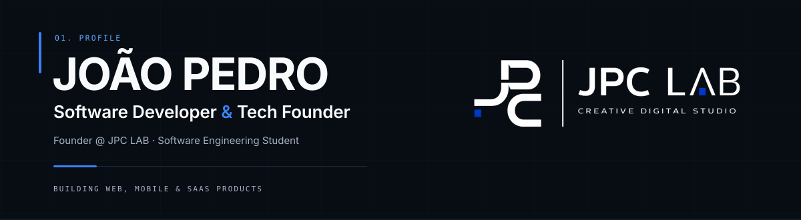
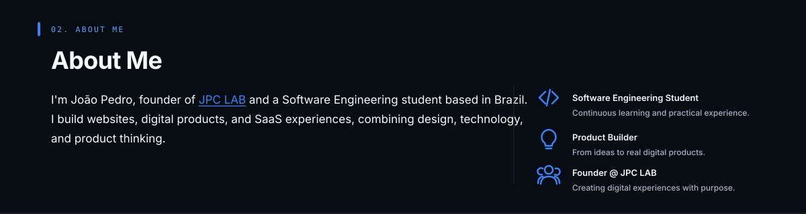
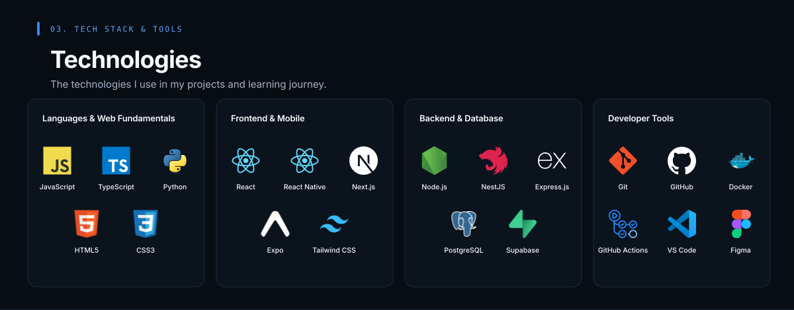
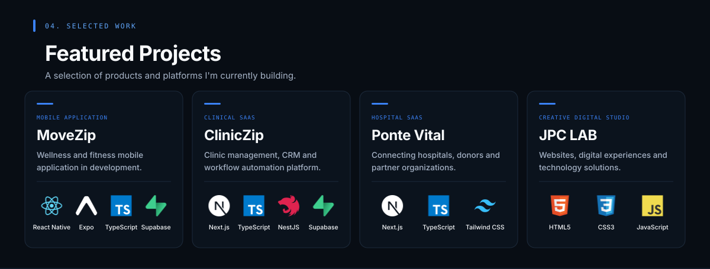
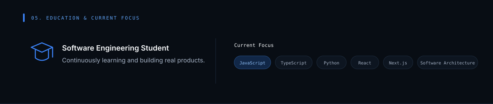
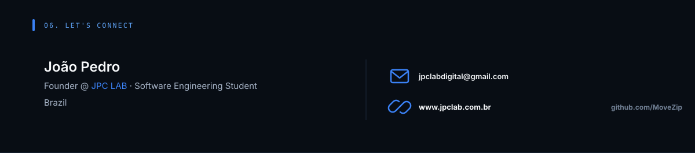

  <picture>
    <source media="(max-width: 600px)" srcset="./assets/hero-mobile.svg" />
    
  </picture>

  <picture>
    <source media="(max-width: 600px)" srcset="./assets/about-mobile.svg" />
    
  </picture>

  <picture>
    <source media="(max-width: 600px)" srcset="./assets/technologies-mobile.svg" />
    
  </picture>

  <picture>
    <source media="(max-width: 600px)" srcset="./assets/featured-projects-mobile.svg" />
    
  </picture>

  <picture>
    <source media="(max-width: 600px)" srcset="./assets/education-focus-mobile.svg" />
    
  </picture>

  <picture>
    <source media="(max-width: 600px)" srcset="./assets/connect-mobile.svg" />
    
  </picture>

  <a href="mailto:jpclabdigital@gmail.com">Email</a>
  &nbsp;&nbsp;·&nbsp;&nbsp;
  <a href="https://www.jpclab.com.br">JPC LAB</a>
  &nbsp;&nbsp;·&nbsp;&nbsp;
  <a href="https://github.com/MoveZip">GitHub</a>

